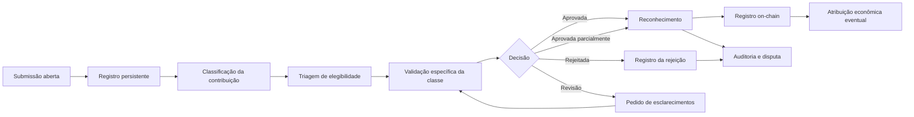

# Metodologia de validação do PoUW estendido MeshWave

**Complemento da missão de anterioridade e análise técnica do PoUW**  
**Autor:** Diogenes Duarte Sobral  
**ORCID:** [0009-0005-3602-4906](https://orcid.org/0009-0005-3602-4906)  
**Status:** proposta metodológica para especificação e validação  
**Escopo:** contribuições computacionais e não computacionais úteis ao ecossistema MeshWave

## 1. Objetivo e escopo

Este documento complementa a missão de anterioridade e a análise técnica do PoUW do repositório. Seu objetivo é estabelecer um processo auditável para identificar, documentar, validar e reconhecer contribuições não computacionais que produzam utilidade mensurável para o ecossistema MeshWave.

A metodologia abrange trabalho intelectual e produção de conhecimento, desenvolvimento e documentação, curadoria, revisão e validação, suporte e coordenação, governança, disponibilização de recursos materiais e contribuições financeiras destinadas a finalidades autorizadas. A submissão de uma contribuição não implica aprovação, emissão automática de UMS ou participação no consenso da blockchain.

A metodologia não define, por si só, uma fórmula econômica definitiva, conclusão jurídica, enquadramento tributário ou prova de que a rede já possua validação PoUW independente em produção.

## 2. Definição operacional

Para esta metodologia, **PoUW estendido** é o conjunto de evidências, verificações e decisões de reconhecimento que demonstra que um participante realizou, forneceu ou viabilizou uma contribuição mensurável, relevante e autorizada para a operação, manutenção, expansão, segurança, capacidade, conhecimento ou utilidade do ecossistema MeshWave.

A contribuição pode ser computacional ou não computacional. Seu reconhecimento pode ocorrer independentemente da seleção de blocos e da função de consenso da blockchain.

A definição contém seis requisitos:

1. **Contribuição:** deve existir ação, entrega, disponibilização ou resultado atribuível a um participante.
2. **Autorização ou elegibilidade:** a atividade deve estar vinculada a tarefa, política, chamada, função ou classe aceita pela MeshWave.
3. **Mensurabilidade:** deve existir unidade, evento, artefato, período, quantidade ou indicador observável.
4. **Relevância ecossistêmica:** deve haver benefício para uma função definida da MeshWave.
5. **Evidência e validação:** deve existir material suficiente para aplicação do critério correspondente.
6. **Reconhecimento:** uma regra, algoritmo, conjunto de validadores ou processo de governança deve aceitar a contribuição e atribuí-la ao participante.

A palavra “prova” não exige que todas as classes possuam uma prova criptográfica do mesmo tipo. Uma contribuição computacional pode usar certificado verificável; uma especificação pode exigir revisão técnica; um serviço pode exigir aceite e verificação de resolução; uma doação material pode exigir recebimento, inventário, uso e resultado.

## 3. Ciclo de vida da contribuição

O processo recomendado é:



Cada submissão deve possuir estado versionado. Os estados mínimos são:

- `SUBMITTED`: contribuição recebida;
- `REGISTERED`: contribuição registrada com identificador persistente;
- `ELIGIBILITY_REVIEW`: análise de enquadramento;
- `UNDER_VALIDATION`: validação em andamento;
- `ACCEPTED`: contribuição aceita;
- `PARTIALLY_ACCEPTED`: contribuição aceita apenas em parte;
- `REJECTED`: contribuição rejeitada;
- `DISPUTED`: decisão contestada;
- `FINALIZED`: decisão consolidada.

Uma contribuição em `SUBMITTED`, `REGISTERED` ou `UNDER_VALIDATION` não deve gerar UMS definitiva.

## 4. Registro da submissão

O acesso à submissão pode ser aberto aos participantes elegíveis, mas a aprovação deve ser controlada por administradores ou validadores autorizados. O registro mínimo recomendado é:

```text
contribution_id
contributor_id
contributor_public_identifier
submission_timestamp
contribution_class
project_topic
related_task_id
related_ecosystem_module
title
description
claimed_utility
evidence_references
conflict_declarations
protocol_version
status
validator_id
decision_timestamp
```

Os tópicos podem ser associados aos módulos da MeshWave, incluindo arquitetura, roteamento, identificação, sandbox global, armazenamento, segurança, governança, economia UMS/MWN, documentação e validação externa.

O histórico não deve ser sobrescrito. Alterações devem produzir novas versões, mantendo a decisão anterior e o motivo da alteração.

## 5. Taxonomia de contribuições

| Classe | Exemplos MeshWave | Evidência primária | Validação possível |
|---|---|---|---|
| Computacional | Execução de jobs, simulação e processamento | Logs, hashes de entrada/saída, certificado | Reexecução, amostragem ou prova sucinta |
| Armazenamento | Retenção, recuperação e preservação | Hash, desafio e prova de recuperação | Desafios aleatórios e leitura verificável |
| Roteamento e infraestrutura | Encaminhamento, caches CPA/CLA e disponibilidade | Registros de rota e eventos de cache | Testes externos e correlação de eventos |
| Software | Código, correção, teste, manutenção e integração | Commit, revisão, build e testes | Revisão independente e implantação controlada |
| Conhecimento | Pesquisa, análise, documentação e especificação | Artefato versionado e referências | Revisão técnica, aceitação e replicação |
| Curadoria | Classificação, organização e validação de dados | Dataset e trilha de alterações | Amostragem, concordância e revisão |
| Validação | Auditoria, checagem e detecção de falhas | Relatório, testes e divergências | Repetição independente e taxa de acerto |
| Serviço e suporte | Atendimento, coordenação e integração | Ticket, entrega e aceite | Aceite do solicitante e amostragem |
| Recurso material | Equipamento, espaço, conectividade e insumo | Recibo, inventário e uso | Inspeção, medição e consumo comprovado |
| Recurso financeiro | Financiamento de tarefa, compra ou manutenção | Recebimento, finalidade e aplicação | Reconciliação, auditoria e resultado |
| Governança | Propostas, deliberação e mediação | Proposta, voto, ata e decisão | Quórum, conflito e rastreabilidade |

A classificação deve ocorrer antes da validação final. Não se deve aplicar uma única métrica a processamento, armazenamento, pesquisa, doação e coordenação.

## 6. Portas obrigatórias de validação

A validação deve separar elegibilidade, existência, autoria, relevância, qualidade, unicidade e utilidade.

### 6.1 Elegibilidade

A contribuição é elegível quando está relacionada a um tópico ou módulo MeshWave, corresponde a uma oportunidade ou finalidade reconhecida, está dentro do período aplicável, possui participante identificável e apresenta evidência mínima. Elegibilidade não equivale a reconhecimento.

### 6.2 Existência

Deve ser demonstrado que a contribuição ocorreu. Exemplos incluem documento versionado, código, registro de revisão, atendimento de chamado, ata, comprovante de entrega, inventário, registro de recebimento ou comprovante de aplicação autorizada.

A declaração do participante, isoladamente, não é evidência suficiente.

### 6.3 Autoria e atribuição

A contribuição deve ser ligada ao participante correto. O registro deve distinguir submissor, produtor, revisor, aprovador e beneficiário econômico. Em contribuições conjuntas, a divisão deve seguir declaração dos participantes ou regra predefinida.

### 6.4 Relevância ecossistêmica

A avaliação deve responder qual função da MeshWave foi beneficiada. Exemplos são melhoria de arquitetura, redução de falhas, melhoria de roteamento, disponibilidade, correção de vulnerabilidade, qualidade de dados, resolução de demanda ou criação de capacidade operacional.

Uma produção intelectual interessante, mas sem relação demonstrável com a MeshWave, pode ser material de referência sem constituir PoUW remunerável.

### 6.5 Qualidade

Os critérios devem ser específicos por classe. Documentação pode exigir completude, precisão, referências e revisão. Software pode exigir testes, segurança, compatibilidade e efeito técnico. Curadoria pode exigir taxa de acerto e consistência. Suporte pode exigir resolução, aceite e ausência de reincidência.

### 6.6 Utilidade efetiva

A utilidade pode ser registrada em níveis:

| Nível | Significado |
|---|---|
| U0 | Utilidade não demonstrada |
| U1 | Utilidade potencial sem uso confirmado |
| U2 | Aceita para uso experimental ou interno |
| U3 | Utilizada por um módulo ou processo MeshWave |
| U4 | Produziu melhoria mensurável ou resolveu necessidade concreta |
| U5 | Impacto confirmado por uso repetido ou por múltiplos módulos |

A política econômica deve definir quais níveis podem gerar UMS e quais resultam apenas em registro, reputação ou prioridade.

### 6.7 Independência da validação

A força da validação deve considerar a independência do avaliador: autoavaliação, administrador, especialista, múltiplos revisores, solicitante, auditoria posterior ou evidência on-chain. Quanto maior o impacto econômico, maior deve ser a independência exigida.

### 6.8 Unicidade e não duplicidade

O mesmo artefato não deve ser recompensado duas vezes sob classes diferentes, salvo regra explícita. Devem ser verificadas reapresentação, atribuição por múltiplas identidades, divisão artificial, dupla contagem de doação e reutilização simultânea de recurso.

## 7. Doações materiais e financeiras

Uma doação não é automaticamente equivalente a trabalho computacional ou intelectual. Para constituir contribuição útil MeshWave, deve produzir utilidade ecossistêmica definida, rastreável, proporcionalmente atribuível e validada.

### 7.1 Doação material

A validação deve incluir:

1. identificação do item ou recurso;
2. especificação e estado;
3. comprovação de entrega;
4. aceite por responsável autorizado;
5. finalidade;
6. demonstração de uso ou disponibilidade;
7. período de utilização;
8. controle de atribuição duplicada;
9. avaliação proporcional ao uso efetivo.

O preço declarado do equipamento não determina sozinho a recompensa. Recurso caro e não utilizado não deve equivaler a recurso integrado e efetivamente utilizado.

### 7.2 Doação financeira

A validação deve incluir:

1. registro da origem e do recebimento;
2. finalidade previamente autorizada;
3. identificação da tarefa ou infraestrutura financiada;
4. comprovação de aplicação;
5. reconciliação;
6. evidência do resultado;
7. controle contra financiamento circular;
8. prevenção contra compra de influência sobre validadores;
9. limites de concentração.

A contribuição financeira pode ser reconhecida como financiamento ecossistêmico, mas não deve comprar automaticamente UMS em proporção direta ao valor transferido. O reconhecimento depende também da aplicação e do benefício verificável.

## 8. Modelo de decisão e reconhecimento econômico

Uma contribuição pode ser reconhecida somente se satisfizer as portas obrigatórias:

```text
Recognize(C) =
  Authorized(C)
  AND SufficientEvidence(C)
  AND Exists(C)
  AND Attributable(C)
  AND Relevant(C)
  AND Unique(C)
  AND Validated(C)
  AND NoBlockingDispute(C)
```

Depois das portas, a recompensa pode considerar qualidade e utilidade:

```text
UMS(C) = class_budget × quality_degree × utility_degree × impact_factor − penalties
```

A expressão é um modelo analítico, não a fórmula econômica atual da MeshWave. A política deverá definir unidades, limites, orçamento, penalidades e autoridade.

A relação funcional é:

```text
Contribuição → Evidência → Validação → Reconhecimento → UMS
```

Conversões posteriores entre UMS e MWN devem ser tratadas separadamente da decisão técnica de que uma contribuição foi útil.

## 9. Registro na blockchain

A blockchain não precisa armazenar o conteúdo integral da contribuição. O registro on-chain pode conter:

- identificador da contribuição;
- hash do artefato e da evidência;
- classe e tópico;
- identificador do participante ou representação pseudonimizada;
- versão do protocolo;
- validadores;
- timestamp;
- decisão;
- quantidade de UMS reconhecida;
- estado de disputa.

O conteúdo completo pode permanecer em armazenamento controlado. A blockchain funciona como camada de integridade, versionamento e auditabilidade, não como substituta de todo o processo de análise.

## 10. Governança, segurança e disputas

O modelo deve tratar Sybil, replay, duplicidade, conluio, manipulação de utilidade, plágio, autoria falsa, doação circular, inflação de UMS e conflito entre privacidade e auditabilidade.

Medidas possíveis incluem identidade vinculada, limites por tarefa, seleção diversa de validadores, separação de funções, revisão cruzada, amostragem posterior, penalidades, auditoria independente, hashes, compromissos criptográficos e divulgação seletiva.

Toda decisão deve registrar versão da regra, classe, tarefa, evidências, validação, qualidade, participantes, validadores, conflitos, UMS atribuída e prazo de recurso. O validador que aprovou a contribuição não deve possuir controle exclusivo sobre o recurso.

## 11. Aplicação ao `meshware_dynrotsimulator`

O simulador pode representar o PoUW estendido inicialmente como eventos e estados, sem afirmar que executa uma prova real em rede distribuída. Cada evento deve poder registrar:

```text
contributor_id
contribution_class
task_id
resource_or_artifact
evidence_id
validation_method
validation_status
recognized_quantity
ums_awarded
validator_set
dispute_status
source_block
```

A simulação do roteamento deve respeitar o escopo inicial sem latência e sem variáveis reais de situação. O modelo pode testar invariantes, duplicidade, rejeição, disputas e limites de emissão, mas os testes não demonstram sozinhos que uma contribuição real ocorreu ou foi útil.

A arquitetura de teste pode separar motor de oportunidades, registro de evidências, validadores por classe, motor de reconhecimento, ledger UMS, conversão MWN/UMS, disputas e persistência.

## 12. Critério metodológico central

A formulação a ser adotada no paper é:

> O PoUW estendido MeshWave não reconhece qualquer atividade declarada como trabalho útil. Ele reconhece somente uma contribuição autorizada, mensurável, atribuível, relevante e validada por critérios específicos da sua classe, com registro auditável e eventual atribuição econômica. A contribuição pode ser computacional, intelectual, material, financeira, organizacional ou de serviço; a prova pode combinar evidência criptográfica, registros operacionais, revisão técnica, aceite, auditoria e governança.

Essa definição amplia o escopo sem transformar a expressão PoUW em uma recompensa automática por participação.

## 13. Relação com a missão existente

Este documento deve ser lido em conjunto com:

- [`ANALISE_TECNICA_POUW.md`](./ANALISE_TECNICA_POUW.md), que descreve os limites do PoUW parametrizado no simulador;
- [`02-arquitetura-cooperativa-sandbox-global-pouw.md`](./02-arquitetura-cooperativa-sandbox-global-pouw.md), que descreve a sandbox global, a contribuição nativa, a oferta adicional e a separação entre domínio privado e recursos cedidos;
- [`VALIDACAO_ROBUSTEZ.md`](./VALIDACAO_ROBUSTEZ.md), que separa consistência do código, propriedades do modelo e validação operacional ou econômica;
- [`PROTOCOLO_VALIDACAO_EXTERNA.md`](./PROTOCOLO_VALIDACAO_EXTERNA.md), que define a pesquisa de utilidade e validação externa sem apresentar o simulador como rede operacional comprovada.

O documento é uma complementação metodológica da missão de anterioridade. Não substitui a análise histórica do termo PoUW nem transforma a proposta conceitual em implementação já validada.
