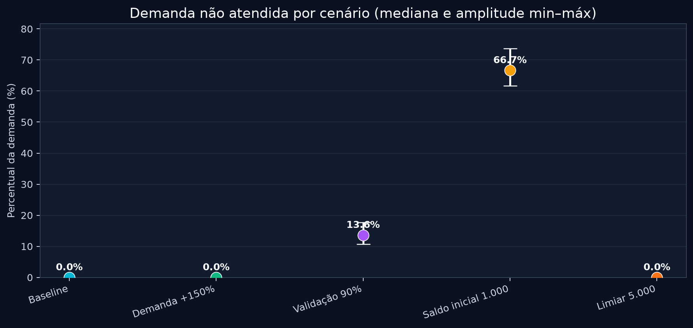
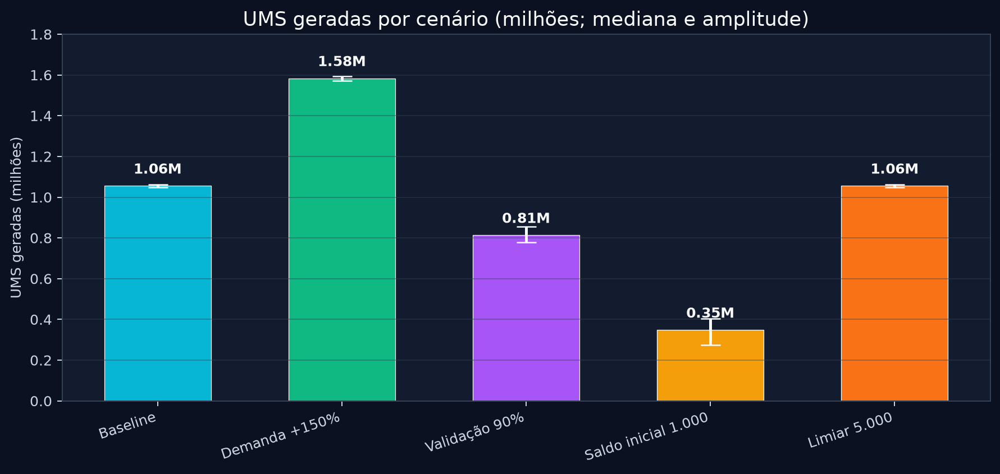
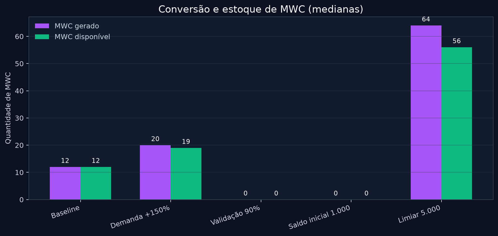
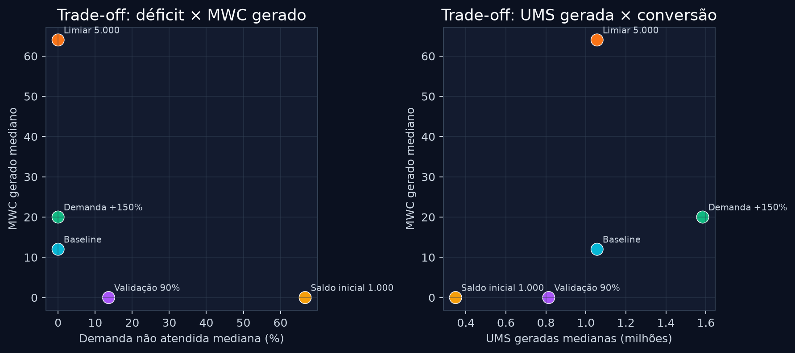

# Relatório da matriz econômica exploratória MWC/UMS

**Versão analisada:** execução atual de `tests/economic-experiments.test.ts`  
**Metodologia:** experimento exploratório one-factor-at-a-time, com seeds pareadas entre cenários  
**Execução:** 5 cenários × 10 seeds × 40 rodadas = **50 execuções**

> Este relatório descreve o comportamento do modelo sob os parâmetros configurados. Não é previsão de mercado, comprovação de viabilidade econômica, evidência de preço/liquidez ou validação de PoUW real.

## 1. Objetivo

A matriz foi criada para observar como alterações isoladas em demanda, validação, saldo inicial e limiar de conversão afetam a capacidade de atendimento, a geração de UMS e a conversão em MWC. As mesmas dez seeds foram reutilizadas nos cinco cenários para reduzir a influência da aleatoriedade ao comparar resultados.

Em todas as 50 execuções, o teste verificou invariantes contábeis: totais agregados iguais à soma dos usuários, saldos finitos e não negativos, coerência entre MWC gerado/disponível/reconvertido e quantidade de operações solicitadas compatível com demanda e rodadas.

## 2. Cenários

| Cenário | Alteração em relação ao padrão |
|---|---|
| **Baseline** | Configuração padrão do simulador. |
| **Demanda +150%** | Demanda de cada serviço multiplicada por 1,5. |
| **Validação 90%** | Taxa de validação PoUW didática reduzida para 90%. |
| **Saldo inicial 1.000** | Saldo inicial de cada usuário reduzido para 1.000 UMS. |
| **Limiar 5.000** | Limiar de conversão UMS → MWC reduzido para 5.000 UMS. |

## 3. Resultados principais

### 3.1. Demanda não atendida



A taxa mediana de demanda não atendida foi:

| Cenário | Mínimo | Mediana | Máximo |
|---|---:|---:|---:|
| Baseline | 0,00% | 0,00% | 0,00% |
| Demanda +150% | 0,00% | 0,00% | 0,00% |
| Validação 90% | 10,69% | **13,64%** | 17,65% |
| Saldo inicial 1.000 | 61,62% | **66,67%** | 73,68% |
| Limiar 5.000 | 0,00% | 0,00% | 0,00% |

O resultado mais sensível foi o cenário de saldo inicial baixo. Na mediana, dois terços da demanda ficaram não atendidos e os dez usuários apresentaram alguma demanda não atendida. A redução da taxa de validação também criou déficit relevante, com mediana de 13,64% e dez usuários afetados na mediana.

O aumento de demanda em 50%, por outro lado, não produziu déficit neste horizonte de 40 rodadas. Isso significa que, sob a configuração padrão, o sistema possuía capacidade suficiente para atender esse aumento; não significa que o resultado se manteria em horizontes maiores ou com saldo inicial menor.

### 3.2. UMS geradas



| Cenário | Mínimo | Mediana | Máximo |
|---|---:|---:|---:|
| Baseline | 1.048.036 | **1.055.793** | 1.061.715 |
| Demanda +150% | 1.572.000 | **1.583.728** | 1.592.550 |
| Validação 90% | 778.529 | **813.835** | 855.755 |
| Saldo inicial 1.000 | 274.907 | **348.531** | 403.111 |
| Limiar 5.000 | 1.048.036 | **1.055.793** | 1.061.715 |

A demanda +150% elevou a geração mediana de UMS para 1.583.728, aproximadamente 50% acima do baseline. A validação a 90% reduziu a geração mediana para 813.835, cerca de 23% abaixo do baseline. O saldo inicial de 1.000 UMS teve o menor resultado de geração, com mediana de 348.531 UMS, porque os usuários passaram a operar sob escassez muito mais cedo.

O cenário de limiar 5.000 não altera a geração de UMS: ele altera principalmente o momento em que o saldo acumulado é convertido em MWC.

### 3.3. Conversão e disponibilidade de MWC



| Cenário | MWC gerado — mediana | MWC reconvertido — mediana | MWC disponível — mediana |
|---|---:|---:|---:|
| Baseline | 12 | 0 | 12 |
| Demanda +150% | 20 | 2 | 19 |
| Validação 90% | 0 | 0 | 0 |
| Saldo inicial 1.000 | 0 | 0 | 0 |
| Limiar 5.000 | **64** | 7 | **56** |

O limiar de conversão é o principal controlador da emissão de MWC: reduzir o limiar de conversão de 10.000 para 5.000 UMS aumentou a mediana de MWC gerado de 12 para 64, aproximadamente 5,3 vezes. Isso ocorreu sem aumentar a geração de UMS; o saldo passou a ser convertido em blocos menores e com maior frequência.

A demanda +150% também elevou o MWC gerado, para mediana de 20, mas aumentou simultaneamente as reconversões, que chegaram a 2 na mediana. A validação reduzida e o saldo inicial baixo não produziram MWC suficiente para conversão na maioria das execuções.

### 3.4. Trade-offs entre déficit, UMS e MWC



O painel esquerdo mostra que o cenário de limiar 5.000 gera mais MWC sem déficit, enquanto o saldo inicial baixo combina alta demanda não atendida com ausência de MWC. O cenário de validação 90% ocupa uma posição intermediária: gera menos UMS, produz pouco ou nenhum MWC e apresenta déficit moderado.

O painel direito separa dois efeitos que poderiam ser confundidos: o cenário de demanda +150% gera mais UMS principalmente porque executa mais operações; o cenário de limiar 5.000 gera quantidade de UMS semelhante ao baseline, mas converte muito mais MWC por usar um limiar menor.

## 4. Leitura por cenário

### Baseline

O cenário padrão funcionou como referência estável. Não houve demanda não atendida, rejeições de validação ou usuários com saldo zero. A geração mediana foi de aproximadamente 1,06 milhão de UMS e a conversão mediana foi de 12 MWC.

### Demanda +150%

O aumento da demanda elevou as operações e a geração de UMS, sem causar déficit no período observado. A mediana de MWC disponível subiu para 19, mas também houve maior reconversão. O resultado sugere que a capacidade configurada absorve o aumento de demanda no curto prazo, mas não testa o limite de saturação do sistema.

### Validação 90%

A redução da taxa de validação diminuiu a geração de UMS e criou operações não atendidas. A mediana de 90.394 UMS rejeitadas mostra que a perda de validação afeta diretamente a capacidade de reconhecimento do trabalho no modelo.

### Saldo inicial 1.000 UMS

Este foi o cenário de maior estresse. O saldo inicial não sustentou a demanda acumulada: todos os usuários tiveram demanda não atendida, a taxa mediana chegou a 66,67% e nenhum MWC foi gerado. O resultado evidencia que o saldo inicial é uma condição de liquidez interna importante para o comportamento do simulador.

### Limiar de conversão 5.000 UMS

O cenário aumentou a frequência de conversão e o estoque de MWC sem alterar a geração de UMS ou o atendimento da demanda. Ele mostra que o limiar é uma variável de política econômica do modelo, não uma fonte adicional de capacidade produtiva.

## 5. Conclusões

1. **Saldo inicial é a maior fonte de sensibilidade operacional:** reduzir o saldo para 1.000 UMS levou a uma taxa mediana de déficit de 66,67%.
2. **Validação PoUW didática é uma variável de capacidade:** reduzir a validação para 90% produziu 13,64% de demanda não atendida na mediana.
3. **Aumento de demanda não implica automaticamente déficit:** com os parâmetros atuais, +150% de demanda ainda foi atendido em 40 rodadas.
4. **Limiar de conversão controla emissão, não produção:** reduzir o limiar para 5.000 UMS multiplicou a conversão em MWC, mas não aumentou a geração de UMS.
5. **Os cenários não são equivalentes a uma economia real:** faltam calibração com dados operacionais, tarefa PoUW concreta, custos reais, concorrência, disponibilidade distribuída, preço de mercado e validação externa.

## 6. Reprodutibilidade e arquivos

A fonte de dados resumida usada neste relatório está em [`data/matriz-economica-summary.json`](data/matriz-economica-summary.json). A matriz é implementada em [`tests/economic-experiments.test.ts`](../tests/economic-experiments.test.ts).

Para reproduzir a execução:

```bash
pnpm exec vitest run tests/economic-experiments.test.ts --reporter=verbose
```

Os quatro gráficos deste relatório foram gerados a partir do JSON produzido pela execução atual, com Python/Matplotlib. Eles mostram medianas e, quando aplicável, a amplitude entre mínimo e máximo das dez seeds por cenário.
